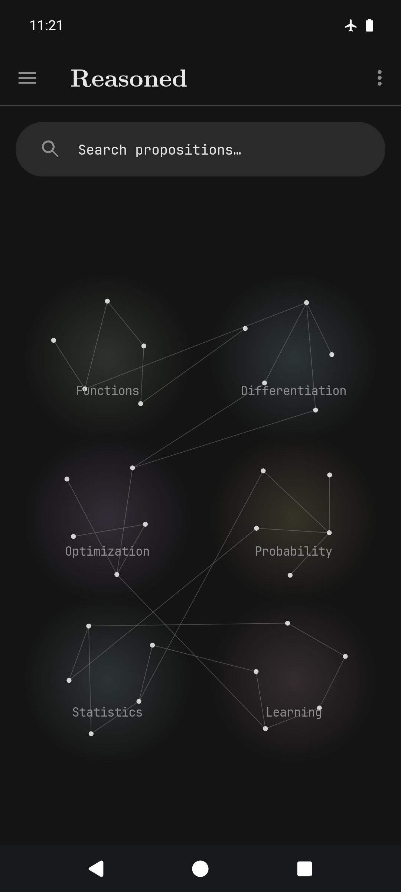
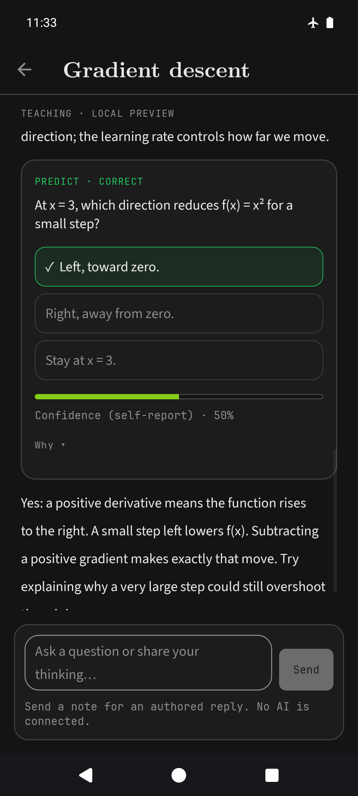
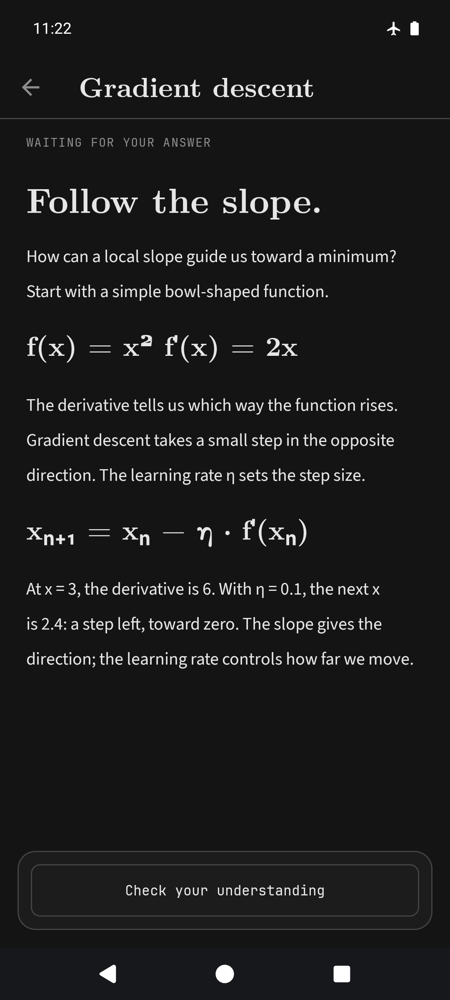

<p align="center">
  
</p>
<h1 align="center">Reasoned</h1>

A native Android learning app inspired by [LearnHarness](https://github.com/amosblomqvist/learnharness)
by [Amos Blomqvist](https://github.com/amosblomqvist). Learn by explaining, predicting and recalling—not
just reading.

## Features

- Guided lessons with learning plans and understanding checks.
- Free-text answers, multiple-choice questions and one-problem-at-a-time practice.
- Saved sessions, drafts and answers.
- A persistent knowledge graph linked to source conversations.
- Markdown, LaTeX, diagrams and horizontally scrolling tables.
- Optional web research with per-session permission.

## Screenshots

<table>
  <tr>
    <th>Sample graph</th>
    <th>Answer & feedback</th>
    <th>Sample lesson</th>
  </tr>
  <tr>
    <td></td>
    <td></td>
    <td></td>
  </tr>
</table>

## Install

**Android 8.0+** · [Download the latest release](https://github.com/kkgosu/reasoned/releases/latest)

1. Open **Settings → Providers & models** and choose a provider. Enter its API key, or connect a
   ChatGPT account.
2. Choose and save a model. Adjust **Learning preferences** if needed.
3. Start a **New session** with something you want to understand. Keep the app open while it generates.

### Build from source

Requires **JDK 21** and **Android SDK Platform 36**. Open the project in Android Studio, or run:

```sh
./gradlew :app:assembleDebug
```

APK: `app/build/outputs/apk/debug/app-debug.apk`.

**Reasoned Debug** installs alongside the release app with separate data and credentials. Its sample
lesson, plan and graph work offline without an account.

## Connections, costs and data

Open **Providers & models** and choose a provider. The picker offers 33 API-key providers, a custom
OpenAI-compatible endpoint, and a ChatGPT plan connection. Each API-key provider keeps its own
encrypted key on this device, and a key is sent only to the provider that owns it. The full list is
in [docs/PROVIDERS.md](docs/PROVIDERS.md).

Request translation and stream parsing are covered by JVM tests. `ProviderWireTest` runs 24 tests
over the Chat, Anthropic and Gemini wires, inline images, native thinking signatures, the provider
registry and the connection ids, and all 24 pass. `ProviderKeylessTest` adds six tests for the
keyless transport rules and verbatim custom endpoint URLs. That is offline verification of the translation layer only. No live API
call has been made to any API-key provider, so account eligibility, model availability,
tool-calling quality and live image acceptance are unverified for each of the 33. The ChatGPT plan
connection was exercised on a device, and the custom
endpoint path was exercised on an API 36 emulator against the local stub at
`scripts/local-provider-stub.mjs`, while every live vendor provider remains unverified.

Lessons, graph extraction, figures, research and context summaries consume model allowance or API
credit. ChatGPT usage and API billing are separate; the app never silently switches connections.
Brave Search requires its own key and has separate billing. AI output and grading can be wrong.

Sessions and the graph are stored on your device; relevant context is sent to the provider you
selected when you make requests. Optional research sends queries to Brave and retrieves public
pages. Credentials use Keystore-backed encryption; the local database is not encrypted.

Export/import and device sync are temporarily hidden from release builds while the upstream
LearnHarness integration is under review; they remain available in debug builds. App backup is
disabled. **Uninstalling or clearing app storage deletes local data.** PDF import and background
agents are not supported.

[Privacy](PRIVACY.md) · [Security](SECURITY.md)

## Contributing

Bug-fix PRs are welcome. For issues, include reproduction steps, your Android version and screenshots—
never credentials or private conversations.

The app uses Kotlin, native Views, AppKit/LiteX and SQLite, with Android structure inspired by
[Mastodon for Android](https://github.com/mastodon/mastodon-android).

[Contributor guide](AGENTS.md) · [Architecture](ARCHITECTURE.md) · [Design system](DESIGN_SYSTEM.md) ·
[Release checklist](docs/RELEASE_CHECKLIST.md)

## License and credits

**AGPL-3.0-only** — see [LICENSE](LICENSE).

The idea, teaching approach, visual direction and bundled teaching instructions come from
**[LearnHarness / Amos Blomqvist](https://github.com/amosblomqvist/learnharness)**.
See [provenance](app/src/main/assets/learnharness/NOTICE.md) and
[source hashes](app/src/main/assets/learnharness/SOURCE.sha256).
Third-party components retain their own licenses: [bundled notices](app/src/main/assets/licenses).
