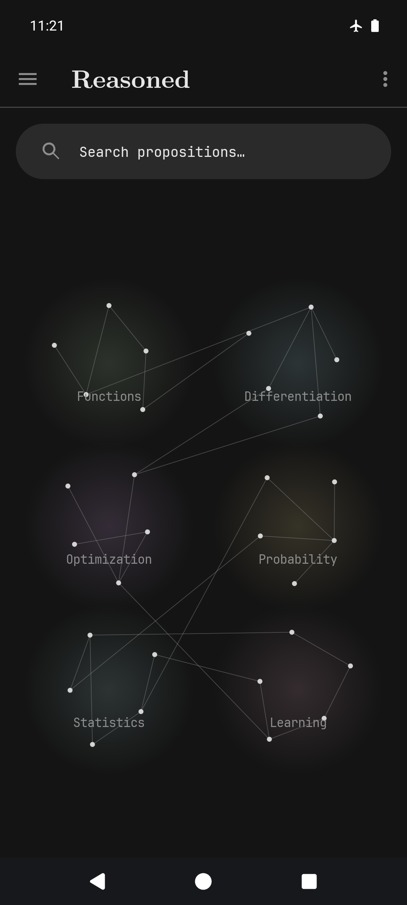
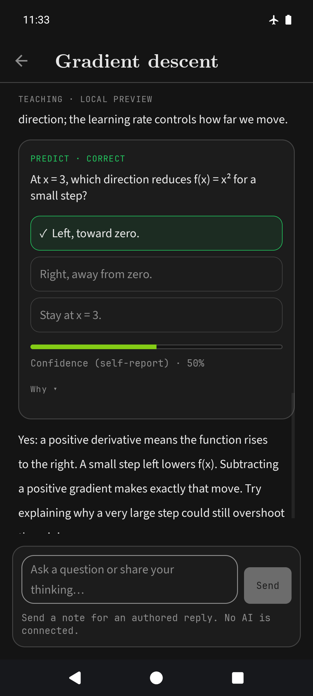
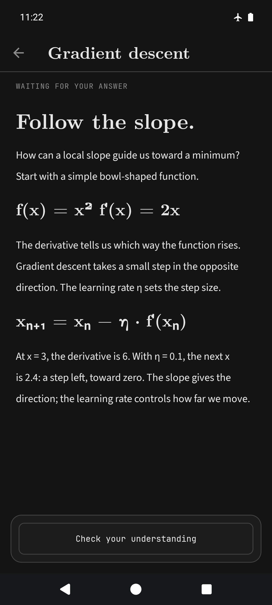

<p align="center">
  
</p>
<h1 align="center">Reasoned</h1>

A native Android learning app inspired by [LearnHarness](https://github.com/amosblomqvist/learnharness)
by [Amos Blomqvist](https://github.com/amosblomqvist). Learn by explaining, predicting and recalling—not
just reading.

## Features

- Guided lessons with learning plans and understanding checks.
- Free-text answers, multiple-choice questions and one-problem-at-a-time practice.
- Saved sessions, drafts and answers.
- A persistent knowledge graph linked to source conversations.
- Markdown, LaTeX, diagrams and horizontally scrolling tables.
- Optional web research with per-session permission.

## Screenshots

<table>
  <tr>
    <th>Sample graph</th>
    <th>Answer & feedback</th>
    <th>Sample lesson</th>
  </tr>
  <tr>
    <td></td>
    <td></td>
    <td></td>
  </tr>
</table>

## Install

**Android 8.0+** · [Download the latest release](https://github.com/kkgosu/reasoned/releases/latest)

1. Open **Settings → Providers & models** and connect a ChatGPT account or enter an OpenAI API key.
2. Choose and save a model. Adjust **Learning preferences** if needed.
3. Start a **New session** with something you want to understand. Keep the app open while it generates.

### Build from source

Requires **JDK 21** and **Android SDK Platform 36**. Open the project in Android Studio, or run:

```sh
./gradlew :app:assembleDebug
```

APK: `app/build/outputs/apk/debug/app-debug.apk`.

**Reasoned Debug** installs alongside the release app with separate data and credentials. Its sample
lesson, plan and graph work offline without an account.

## Connections, costs and data

OpenAI is the only model provider: use a ChatGPT account or an API key. Live API-key use remains
untested. Model availability and limits depend on your account.

Lessons, graph extraction, figures, research and context summaries consume model allowance or API
credit. ChatGPT usage and API billing are separate; the app never silently switches connections.
Brave Search requires its own key and has separate billing. AI output and grading can be wrong.

Sessions and the graph are stored on your device; relevant context is sent to OpenAI when you make
requests. Optional research sends queries to Brave and retrieves public pages. Credentials use
Keystore-backed encryption; the local database is not encrypted.

There is no sync, export/import or app backup. **Uninstalling or clearing app storage deletes local
data.** PDF import and background agents are not supported.

[Privacy](PRIVACY.md) · [Security](SECURITY.md)

## Contributing

Bug-fix PRs are welcome. For issues, include reproduction steps, your Android version and screenshots—
never credentials or private conversations.

The app uses Kotlin, native Views, AppKit/LiteX and SQLite, with Android structure inspired by
[Mastodon for Android](https://github.com/mastodon/mastodon-android).

[Contributor guide](AGENTS.md) · [Architecture](ARCHITECTURE.md) · [Design system](DESIGN_SYSTEM.md) ·
[Release checklist](docs/RELEASE_CHECKLIST.md)

## License and credits

**AGPL-3.0-only** — see [LICENSE](LICENSE).

The idea, teaching approach, visual direction and bundled teaching instructions come from
**[LearnHarness / Amos Blomqvist](https://github.com/amosblomqvist/learnharness)**.
See [provenance](app/src/main/assets/learnharness/NOTICE.md) and
[source hashes](app/src/main/assets/learnharness/SOURCE.sha256).
Third-party components retain their own licenses: [bundled notices](app/src/main/assets/licenses).
